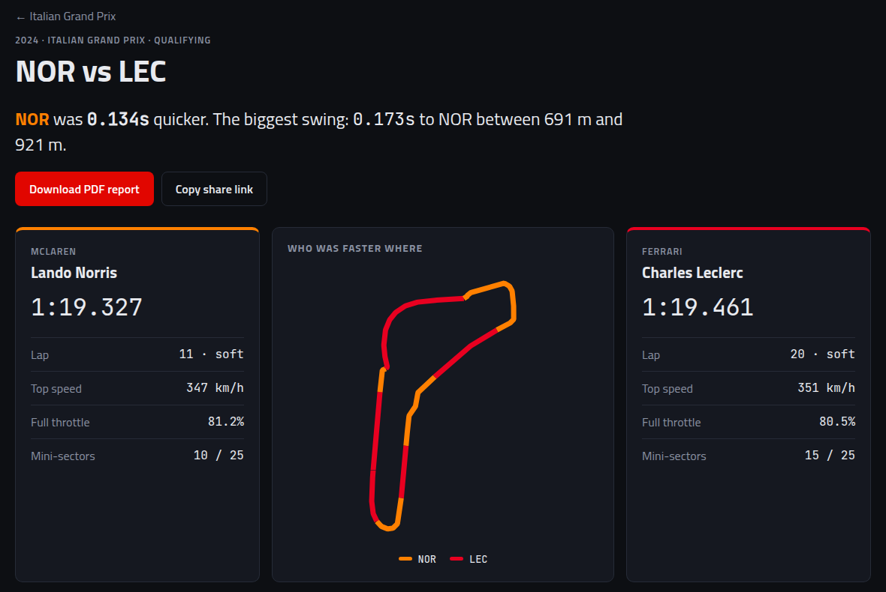

## Hi, I'm Manvith

Computer Engineering student at **Fr. Conceicao Rodrigues College of Engineering, Mumbai** (class of 2028, CGPA 9.29/10). 
I build backend systems and cloud infrastructure, and I like proving with numbers that they work.

**Looking for:** software / backend engineering internships for **Winter 2026 and Summer 2027**, remote or in Mumbai. 
**Reach me:** [manvith.karkera176@gmail.com](mailto:manvith.karkera176@gmail.com) · [LinkedIn](https://www.linkedin.com/in/manvith-karkera-176f)

---

### PitWall: F1 lap telemetry analyzer on AWS
[**Code**](https://github.com/ManvithKarkera/pitwall) · FastAPI · React · PostgreSQL · AWS · CloudFormation

Pick any two F1 drivers' laps and see where the time was won: speed, throttle, brake and gear traces, a running gap, and a track map coloured by who was faster.

- Heavy analysis runs as a background job: the API queues it on **SQS**, a worker on **EC2** processes the telemetry and writes charts and a PDF report to **S3**. Failed jobs retry 3 times, then go to a dead-letter queue that raises an alarm.
- The whole stack (VPC, EC2, RDS, S3, CloudFront, SNS, Lambda, CloudWatch) is one **CloudFormation** template. The database sits in private subnets, IAM is least-privilege, and there's no SSH port.
- Results match official timing: Norris **0.134 s** ahead of Leclerc in 2024 Monza qualifying.

### note2recall: flashcards from your own lecture notes
[**Live**](https://note2recall.vercel.app) · [**Code**](https://github.com/ManvithKarkera/note2recall) · Python · spaCy · scikit-learn · Sentence-Transformers · FastAPI · React

Upload lecture PDFs (scanned ones too, via OCR) and get flashcards. Every card links back to the sentence and page it came from. It uses classic NLP and runs fully locally, with no LLM calls.

- **100%** of answers are found in their source sentence.
- 20-card decks cover **68–96%** of the top 25 concepts in real 78- and 118-page lecture decks.
- Embedding-based duplicate detection: **F1 0.80**, compared with 0.56 for TF-IDF.

### SYN Flood Virtual Lab
[**Code**](https://github.com/ManvithKarkera/css_mini) · JavaScript · Node.js tests

A browser lab that simulates a SYN flood filling a server's TCP connection queue, then lets you switch on defences (SYN cookies, rate limiting, firewall filtering) and watch it recover. I led the 5-person team and wrote the deterministic simulation engine.

### Also built
- **[Hack Into PCell](https://github.com/41vi4p/Hack_Into_PCell_ESP32)**: wrote the ESP32 firmware (C/C++) for a 15-node offline campus treasure hunt. Each node runs its own Wi-Fi hotspot, web server and per-team login.
- **Project Cell website** for Fr. CRCE (Next.js, Vercel), used by 200+ students.

---

**Languages:** Python · C · C++ · JavaScript · TypeScript · Java · SQL 
**Backend & cloud:** FastAPI · PostgreSQL · AWS · Docker · Linux · pytest 
**ML & NLP:** spaCy · scikit-learn · Sentence-Transformers · Pandas · NumPy 
**Embedded:** ESP32 · Arduino
